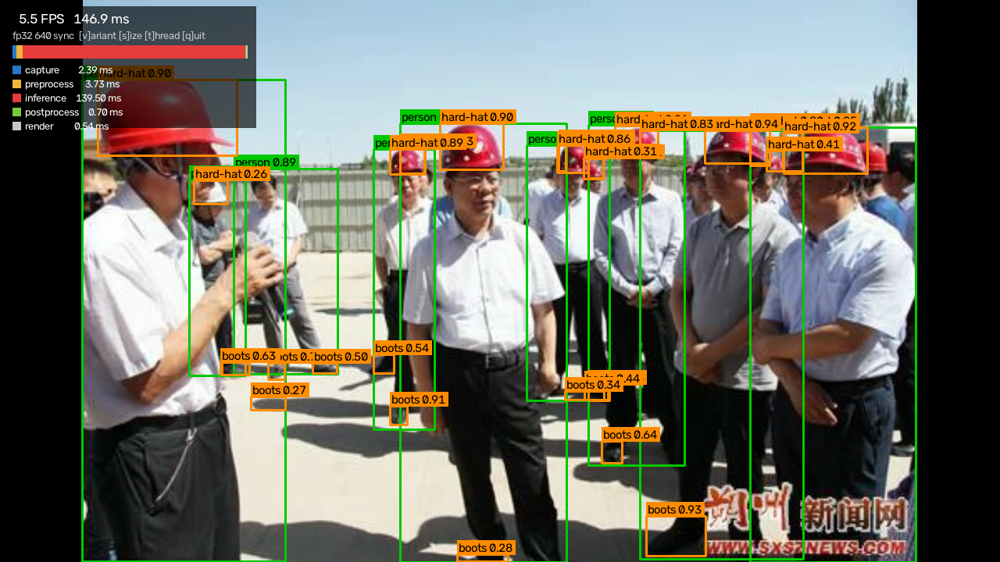
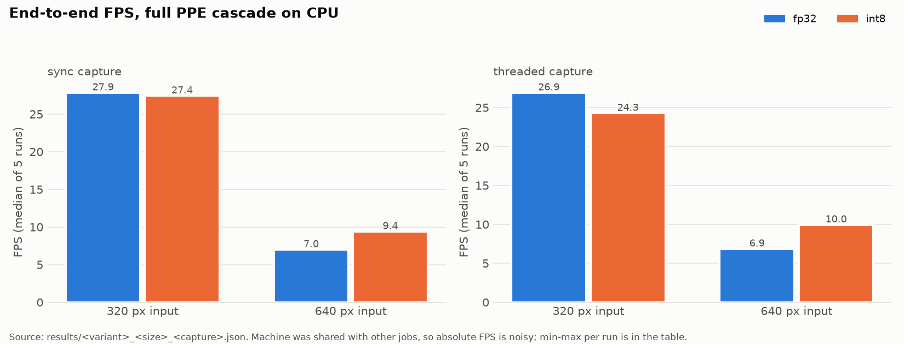
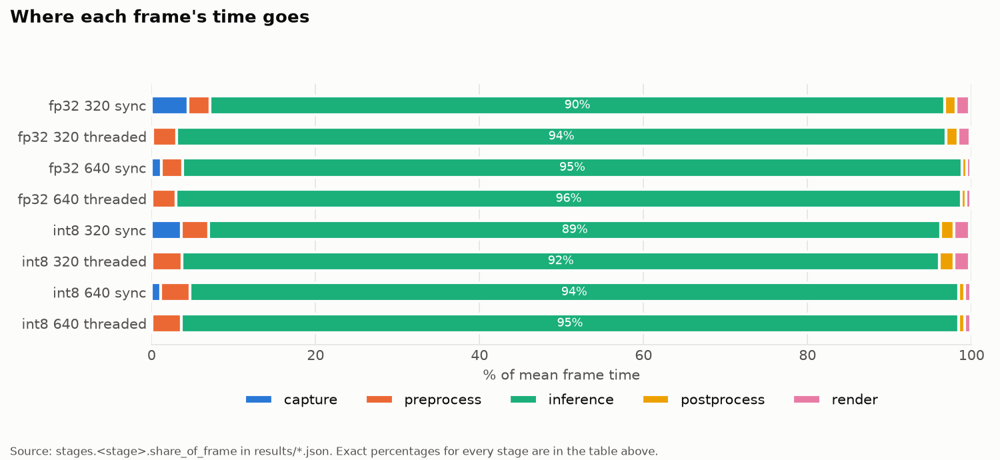

# ppe-live-profiler

A real-time camera inference pipeline with a profiler built in. It runs a two-stage cascade
(person detector on the frame, then a PPE detector on each person crop) on ONNX Runtime CPU,
times every stage of every frame with `time.perf_counter`, and shows where the milliseconds go.

Pipeline per frame: `capture -> preprocess (letterbox to 320 or 640) -> inference (ONNX Runtime CPU) ->
postprocess (YOLOv8 decode + NMS) -> render`. Preprocess, inference and postprocess are summed over
the person model and every PPE crop in the frame.



The screenshot is `ppe_live/screenshot.py` rendering frame 120 of the test video (the frame with the
most PPE boxes, so a heavy frame) with the same `draw_frame` code the live window uses. The FPS shown in it is
that one frame while other jobs were running on the machine, not a benchmark result.

## Layout

| Path | What |
|---|---|
| `ppe_live/pipeline.py` | letterbox, YOLOv8 decode + NMS, `Detector`, `Cascade`, per-stage timing |
| `ppe_live/sources.py` | webcam / video source, optional background capture thread |
| `ppe_live/render.py` | boxes, labels, FPS, stacked per-stage latency bar |
| `ppe_live/app.py` | the OpenCV window |
| `ppe_live/benchmark.py` | headless benchmark of every config -> `results/*.json` |
| `ppe_live/render_table.py` | renders the tables below from `results/*.json` |
| `scripts/prepare_models.py` | copies the project-1 models, builds the 320 variants |
| `scripts/make_test_video.py` | builds `data/test_video.mp4` from the 40 held-out person test images |

## Setup

```bash
uv venv --python 3.12 .venv
uv pip install --python .venv/bin/python -r requirements.txt
.venv/bin/python scripts/prepare_models.py       # models/ (gitignored) + results/model_provenance.json
.venv/bin/python scripts/make_test_video.py      # data/test_video.mp4 (200 frames, 4.3 MB, committed)
```

## Run

```bash
.venv/bin/python -m ppe_live.app --source 0                          # webcam
.venv/bin/python -m ppe_live.app --source data/test_video.mp4        # video file (loops)
.venv/bin/python -m ppe_live.app --variant int8 --size 320 --threaded
.venv/bin/python -m ppe_live.benchmark                               # all 8 configs, 3 repeats -> results/
.venv/bin/python -m ppe_live.benchmark --repeats 5                   # what produced the table below
.venv/bin/python -m ppe_live.render_table --readme README.md         # re-render the tables below
.venv/bin/python -m ppe_live.screenshot                              # docs/screenshot.png
.venv/bin/python -m pytest -q
```

Window keys: `v` fp32/int8, `s` input 320/640, `t` threaded capture on/off, `q` quit.
For a headless smoke test of the same loop: `--no-display --max-frames 20 [--keys "vst"]`.

## Results

<!-- charts:start -->
### Charts

Drawn from the JSON in `results/` by `scripts/make_charts.py`; the tables below hold the exact numbers.




<!-- charts:end -->

Benchmark: `--repeats 5` over `data/test_video.mp4` (200 frames, 1280x720, 40 test images held for 5
frames each), 10 warm-up frames per
config, configs interleaved across repeats. Every number below is generated from the JSON in `results/`.

<!-- results:start -->
Median / p95 ms per stage, summed over the person model and every PPE crop in a frame. FPS and CPU% are the median of the repeats; CPU% is percent of one core (100 = one core busy).

| variant | input | capture | preprocess | inference | postprocess | render | FPS (min-max) | CPU% | source |
|---|---|---|---|---|---|---|---|---|---|
| fp32 | 320 sync | 0.99 / 4.87 | 0.79 / 2.32 | 27.58 / 80.46 | 0.38 / 1.39 | 0.45 / 1.25 | 27.9 (19.6-32.0) | 557 | `results/fp32_320_sync.json` |
| fp32 | 320 threaded | 0.01 / 0.03 | 0.87 / 3.04 | 30.05 / 85.98 | 0.39 / 1.57 | 0.45 / 1.18 | 26.9 (16.3-33.4) | 523 | `results/fp32_320_threaded.json` |
| fp32 | 640 sync | 1.08 / 5.38 | 3.09 / 11.16 | 113.12 / 368.19 | 0.64 / 2.54 | 0.63 / 1.96 | 7.0 (4.6-8.0) | 408 | `results/fp32_640_sync.json` |
| fp32 | 640 threaded | 0.01 / 0.02 | 3.12 / 10.72 | 103.68 / 348.42 | 0.63 / 2.41 | 0.57 / 1.58 | 6.9 (6.3-9.2) | 430 | `results/fp32_640_threaded.json` |
| int8 | 320 sync | 0.89 / 4.46 | 1.06 / 3.02 | 30.47 / 77.49 | 0.48 / 1.69 | 0.62 / 1.53 | 27.4 (18.0-30.7) | 576 | `results/int8_320_sync.json` |
| int8 | 320 threaded | 0.01 / 0.02 | 1.12 / 3.03 | 29.83 / 76.55 | 0.46 / 1.77 | 0.63 / 1.48 | 24.3 (20.7-34.4) | 524 | `results/int8_320_threaded.json` |
| int8 | 640 sync | 0.83 / 2.95 | 2.96 / 10.24 | 79.94 / 248.49 | 0.57 / 2.17 | 0.68 / 1.62 | 9.4 (8.2-10.2) | 461 | `results/int8_640_sync.json` |
| int8 | 640 threaded | 0.01 / 0.02 | 2.96 / 9.49 | 77.26 / 240.93 | 0.55 / 2.19 | 0.64 / 1.58 | 10.0 (8.3-10.6) | 476 | `results/int8_640_threaded.json` |

Share of mean frame time (stage mean / frame mean; capture thread time is not in the main loop):

| variant | input | capture | preprocess | inference | postprocess | render | of which person-infer | of which ppe-infer |
|---|---|---|---|---|---|---|---|---|
| fp32 | 320 sync | 4.4% | 2.7% | 89.6% | 1.4% | 1.6% | 25.7% | 63.9% |
| fp32 | 320 threaded | 0.2% | 2.9% | 93.8% | 1.5% | 1.5% | 27.0% | 66.8% |
| fp32 | 640 sync | 1.2% | 2.6% | 95.0% | 0.6% | 0.5% | 24.1% | 70.9% |
| fp32 | 640 threaded | 0.0% | 3.0% | 95.7% | 0.6% | 0.5% | 24.3% | 71.4% |
| int8 | 320 sync | 3.7% | 3.3% | 89.3% | 1.6% | 1.8% | 27.2% | 62.1% |
| int8 | 320 threaded | 0.1% | 3.6% | 92.4% | 1.7% | 1.9% | 30.3% | 62.0% |
| int8 | 640 sync | 1.1% | 3.6% | 93.8% | 0.8% | 0.7% | 25.2% | 68.6% |
| int8 | 640 threaded | 0.0% | 3.6% | 94.7% | 0.8% | 0.7% | 26.3% | 68.5% |

Headline numbers (computed from the same JSON):

- Best config by median FPS: fp32 320 sync at 27.9 FPS.
- INT8 vs FP32 end-to-end FPS, 320 sync: 27.9 -> 27.4 (-2%); inference median 27.6 -> 30.5 ms.
- INT8 vs FP32 end-to-end FPS, 320 threaded: 26.9 -> 24.3 (-10%); inference median 30.1 -> 29.8 ms.
- INT8 vs FP32 end-to-end FPS, 640 sync: 7.0 -> 9.4 (+34%); inference median 113.1 -> 79.9 ms.
- INT8 vs FP32 end-to-end FPS, 640 threaded: 6.9 -> 10.0 (+45%); inference median 103.7 -> 77.3 ms.
- Threaded vs sync capture, fp32 320: 27.9 -> 26.9 FPS (-3%); capture stage median 0.99 -> 0.01 ms.
- Threaded vs sync capture, int8 320: 27.4 -> 24.3 FPS (-12%); capture stage median 0.89 -> 0.01 ms.
- Threaded vs sync capture, fp32 640: 7.0 -> 6.9 FPS (-2%); capture stage median 1.08 -> 0.01 ms.
- Threaded vs sync capture, int8 640: 9.4 -> 10.0 FPS (+6%); capture stage median 0.83 -> 0.01 ms.
- Slowest stage, fp32 320 sync: inference (89.6% of mean frame time).
- Slowest stage, fp32 320 threaded: inference (93.8% of mean frame time).
- Slowest stage, fp32 640 sync: inference (95.0% of mean frame time).
- Slowest stage, fp32 640 threaded: inference (95.7% of mean frame time).
- Slowest stage, int8 320 sync: inference (89.3% of mean frame time).
- Slowest stage, int8 320 threaded: inference (92.4% of mean frame time).
- Slowest stage, int8 640 sync: inference (93.8% of mean frame time).
- Slowest stage, int8 640 threaded: inference (94.7% of mean frame time).
- Detections per 200-frame pass (conf 0.25), fp32 320: 533 person, 1290 PPE.
- Detections per 200-frame pass (conf 0.25), fp32 640: 590 person, 1536 PPE.
- Detections per 200-frame pass (conf 0.25), int8 320: 520 person, 1155 PPE.
- Detections per 200-frame pass (conf 0.25), int8 640: 586 person, 1418 PPE.
- Machine load (1-min load average, 10 cores) before each run: min 12.5, median 23.1, max 34.3.
<!-- results:end -->

### Where the time went

The tables above are the evidence; this paragraph only restates them.

ONNX Runtime inference is the largest stage in all 8 configurations (89% to 96% of mean frame time in the
share table), and within it the PPE model, which runs once per person crop, accounts for more of the
frame than the person model. Capture, preprocess, postprocess and render together are the remaining
about 4% to 11%. The non-inference stages are a larger share of the frame at 320 (6% to 11%) than at 640 (4% to 6%). INT8 reduced inference time and raised FPS at 640 (about +34% sync, +45% threaded)
(at 640 sync the FP32 and INT8 FPS ranges across repeats do not overlap; threaded they do slightly)
but not at 320, where FP32 and INT8 are within the run-to-run spread. Threaded capture drops the capture stage in the
main loop to about 0.01 ms median, but end-to-end FPS changes by -12% to +6% across the four size/variant pairs, inside the
spread between repeats, so these runs do not show a threaded-capture benefit or cost. Why INT8 does not help at 320 is not
measured here; I did not profile inside ONNX Runtime.

### Caveats

- **The machine was not idle.** Another job was running at the same time (the load average, 10 cores, was between 12.5 and
  34.3 before the runs, see the headline lines). Absolute FPS and the p95 columns are noisy and probably pessimistic; the
  FPS min-max column shows the spread across the 5 repeats. Treat differences smaller than that spread as noise. A rerun on an idle machine is the fix.
- **320 models are derived, not trained or exported at 320.** The project-1 models only take 640x640. `prepare_models.py`
  rebuilds the baked-in anchor grid and stride constants for 320 (it first checks that the same builder reproduces the 640
  constants exactly) and sets the input to 320x320. The 320 graphs run and give the right output shape, and on the
  test video they find somewhat fewer boxes than the 640 ones, but accuracy at 320 was **not** evaluated, so the 320 rows are latency numbers only.
- **Webcam not verified.** `--source 0` is implemented through the same `Source` class, but this environment has no
  camera (`cannot open source '0'`). Everything was verified with the video file. The window opened and ran 15 frames
  without error, but I could not look at it, so the screenshot comes from the same render code and not from a window capture.
- **Test video frames repeat.** Each image is held for 5 frames, so consecutive frames are identical; this makes the
  workload a little different from a live camera. Detections thresholds: confidence 0.25, NMS IoU 0.45, persons smaller than 16 px skipped.
- **CPU%** is `psutil` process CPU time over wall time, so 400 means about four cores busy; ONNX Runtime used its default thread count (all cores).

## Data and model provenance

- Models: the YOLOv8n person and PPE detectors (FP32 and INT8 ONNX) from the sibling project
  `ppe-quantization-lab` (`models/{person,ppe}_{fp32,int8}.onnx`), copied into `models/`. Source paths and SHA-256 of every source
  file, 640 copy and 320 derivative are in `results/model_provenance.json`. The PPE model has 7 classes
  (hard-hat, gloves, mask, glasses, boots, vest, ppe-suit) and was trained on person crops, which is why the pipeline is a cascade.
- Images: the 40 held-out person test images from that project's `data/split.json` (seed 0). `make_test_video.py` asserts the
  folder matches the split's test file list before building the video.
- The original two-stage idea comes from the `Yolov8_Person_and_PPE_detection` repository's `inference.py`.
